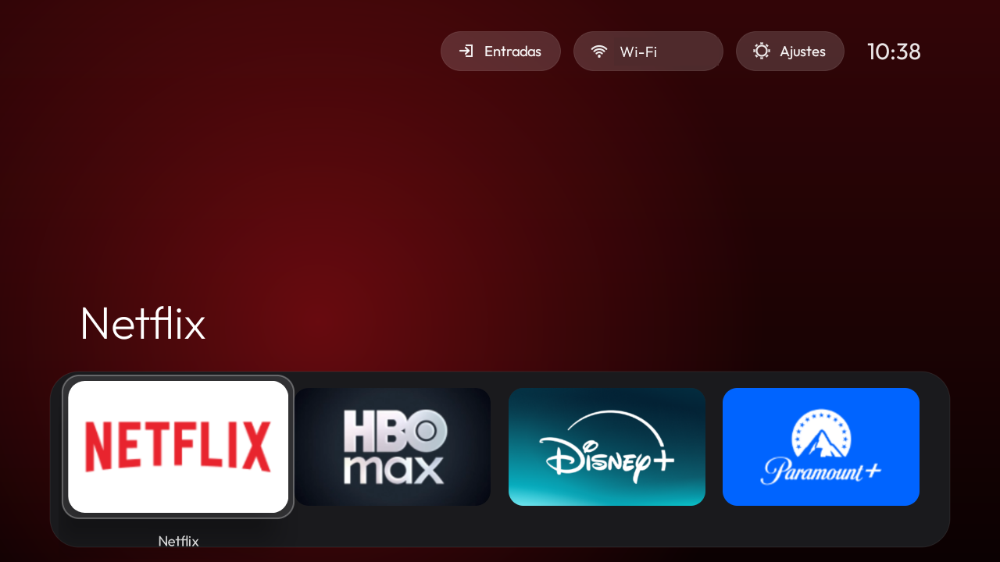
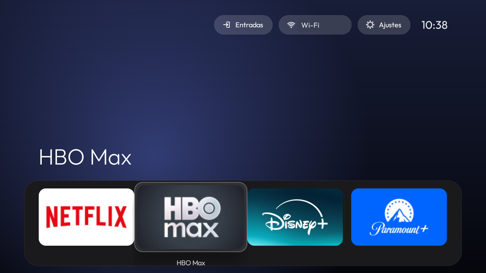

# GlassTV

**Limpia un Android TV de bloatware, ponle una pantalla de inicio de cristal estilo Apple TV y transmite desde un iPhone con AirPlay.**
*(English: [README.md](README.md))*

<p align="center">
  
  
</p>

GlassTV son tres piezas que trabajan juntas sobre un Android TV / Google TV de serie, todo por ADB (sin root):

| Pieza | Qué hace |
|---|---|
| [`debloat/`](debloat) | Hace copia de seguridad, desactiva telemetría, contenido del fabricante y apps preinstaladas una a una (nunca desinstala), rechaza una lista protegida y puede deshacerlo todo. |
| [`launcher/`](launcher) | Launcher nativo ligero (Java, ~50 MB de RAM, sin blur ni vídeo): banda de dock, rejilla de apps, un único resalte de cristal con muelle que salta entre iconos, fondo ambiental con el color de la app enfocada, reloj, píldoras de Wi-Fi y Ajustes y menú de Entradas (HDMI, AV, TV en directo, iPhone). Navegación con el mando determinista. |
| [`airplay-receiver/`](airplay-receiver) | Parches y notas de compilación en Windows para el receptor de código abierto [android-airplay-server](https://github.com/jqssun/android-airplay-server): duplicación de pantalla, música y vídeo AirPlay desde las apps, visible para los iPhone en cuanto la TV está encendida. |

Probado en un Xiaomi MiTV-MOSR2 (Google TV con Android 11, 1,4 GB de RAM, ARM de 32 bits).

## Notas de ingeniería (lo interesante)

- **Tomar el Home en Google TV.** `cmd package set-home-activity` imprime `Success` y no hace nada. El Home solo pasó al launcher propio al
  desactivar el launcher de serie *y* el asistente de configuración que secuestra el Home. Al desactivar ese asistente Android borra las
  redes Wi-Fi que creó, así que las herramientas comprueban antes cuál es suya.
- **Un botón del mando muerto, explicado.** Tras desactivar el launcher de serie, la tecla Ajustes dejó de funcionar. Siguiendo
  `KEYCODE_SETTINGS` por los registros del gestor de ventanas apareció un `GlobalKeyReceiver` del fabricante que se caía al arrancar de forma
  explícita la actividad de panel del launcher de serie ("process is bad"). La guía recoge dos arreglos y sus pros y contras.
- **El vídeo AirPlay de las apps daba 404.** El receptor solo servía la lista HLS maestra para la ruta exacta `/master.m3u8`; iOS añade una
  query string. El parche `0010` compara la ruta, corrige un búfer sin inicializar al reescribir la lista (incidencia
  [#79](https://github.com/jqssun/android-airplay-server/issues/79) del proyecto original) y reproduce directamente las listas `http(s)`,
  como un Apple TV. Además el vídeo directo sigue sonando cuando el iPhone se bloquea y cierra sus conexiones.
- **Compilar OpenSSL y FFmpeg para Android desde Windows.** El proyecto asume Linux. Arreglos: bash en lugar de `cmd`, normalización de rutas
  en la configuración Android de OpenSSL, un envoltorio de `clang` que pasa las listas largas de argumentos por un archivo de respuesta (el
  límite de 32.767 caracteres de Windows rompía el enlazado de `libcrypto.so`), OpenSSL estático, rutas `pwd -W` para el `make` de FFmpeg y
  un perl al que se le aportan por separado los módulos que faltan. Ver [`airplay-receiver/windows-build`](airplay-receiver/windows-build).
- **Privacidad al depurar.** Los registros del receptor contienen la dirección de cada vídeo enviado. `cap.sh` se ejecuta en la TV y descarta
  toda línea con una URL antes de que llegue nada al PC.
- **Duplicación que llena la pantalla.** Las imágenes anchas (un iPhone en horizontal) se escalan para llenar una pantalla 16:9 recortando como
  máximo el 35 %; la tecla Menú alterna ajustar / rellenar / estirar.

## Inicio rápido

```powershell
$env:TV_HOST = "192.168.1.50:5555"      # tu TV, ADB por red
cd debloat
.\disable.ps1 com.fabricante.analytics  # un paquete cada vez, con la lista protegida
.\restore-tv.ps1                        # deshacer todo
cd ..\launcher
.\install.ps1                           # compila, instala y abre (JDK 11, Android SDK 33; Gradle viene en el wrapper incluido)
```

Lee antes [docs/GUIA.es.md](docs/GUIA.es.md): explica cómo comprobar que una TV admite todo esto, la copia de seguridad, la toma del Home y el receptor AirPlay.

## Límites

- Necesita Android TV con acceso ADB. Una TV con sistema propio no se puede limpiar ni admite apps.
- Un receptor AirPlay que no es de Apple no puede reproducir contenido con DRM (Apple TV+, Disney+, Prime Video); en duplicación esas apps salen en negro.
- Los enlaces firmados para la sesión del iPhone pueden rechazarse (HTTP 410/400). La duplicación se detiene al bloquear el iPhone (iOS deja de
  enviar imagen, igual que en un Apple TV); el botón AirPlay de la app no.
- **Desactivar paquetes puede dejar una TV sin arrancar** si se incluye uno esencial. Haz copia primero, desactiva en lotes pequeños y reinicia
  para comprobar. Lo haces bajo tu responsabilidad.

## Licencia y créditos

- Launcher, scripts de debloat y documentación: [MIT](LICENSE).
- `airplay-receiver/`: parches a software GPL-3.0, distribuidos bajo [GPL-3.0](airplay-receiver/LICENSE-GPL-3.0.txt).
  Proyectos originales: [android-airplay-server](https://github.com/jqssun/android-airplay-server) y [UxPlay](https://github.com/FDH2/UxPlay).
- Tipografía: [Outfit](https://github.com/google/fonts/tree/main/ofl/outfit), SIL Open Font License.
- Sin relación ni respaldo de Apple, Google, Xiaomi o Netflix. "Apple TV" y "AirPlay" son marcas de Apple Inc.;
  el inicio es un diseño independiente y no usa recursos de Apple.
